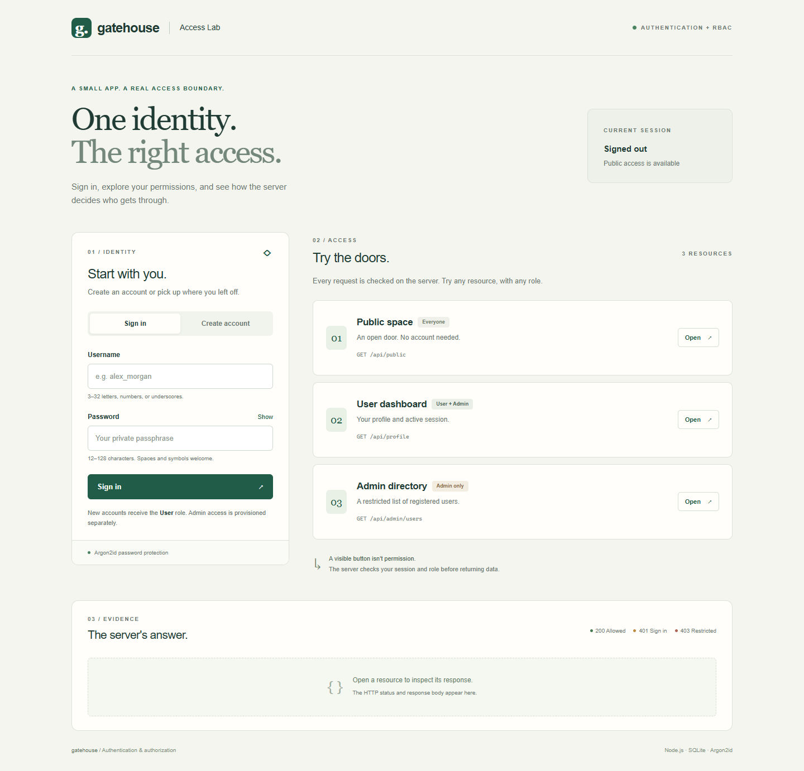
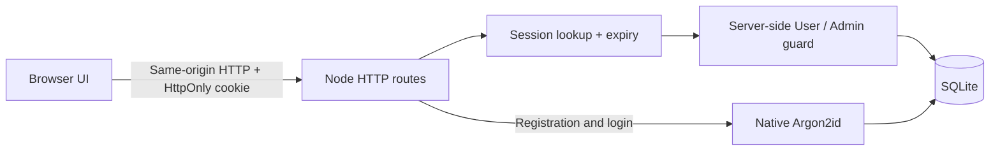

# Gatehouse — Authentication & Role-Based Access Control

A small full-stack access lab for the Week 02 assignment. Register, sign in, inspect a User profile, and try an Admin-only directory. Every resource button stays visible so you can demonstrate that permission is enforced by the server.

**Stack:** Node.js 24, native HTTP server, native SQLite, native Argon2id, and plain HTML/CSS/JavaScript. There are **no third-party runtime dependencies** and no frontend build step. Password hashing uses Node's cryptographic implementation, not a home-grown Argon2 algorithm.



## Run locally

Install **Node.js 24.7 or newer within the 24.x series** from [Node.js](https://nodejs.org/en/download). The verified runtime was **24.19.0**. Earlier Node releases do not have the required `crypto.argon2` API. Open a terminal in this project directory, then run:

```sh
node --version
node scripts/setup.mjs
node --env-file=.env scripts/create-admin.mjs
node --env-file=.env server.mjs
```

1. `setup.mjs` creates a private `.env` with a fresh 32-byte random secret. It never overwrites an existing `.env`.
2. The Admin command asks for a **new** username and password in an interactive terminal. Password entry is hidden. It never promotes or overwrites an existing account. Choose your own throwaway credentials for the recording.
3. Open **[http://127.0.0.1:3000](http://127.0.0.1:3000)**. Use this exact host; `localhost` is a different configured origin.
4. Create a normal User through the web interface, then sign in. Public registration cannot create an Admin.
5. Stop the server with **Ctrl+C**. Accounts persist in `data/gatehouse.sqlite` between restarts.

No `npm install` is required. The equivalent npm shortcuts are `npm run setup`, `npm run admin`, `npm start`, `npm test`, and `npm run inspect`.

If port 3000 is occupied, change **both** `PORT` and the port in `APP_ORIGIN` inside `.env`. Keep local HTTP bound to `127.0.0.1`. `.env.example` documents every setting. The ZIP contains no `.env`, real database, configured Admin credentials, or live session tokens. Test files contain only disposable fixture passwords.

## Explore the permissions

| Resource | Endpoint | Signed out | User | Admin |
| --- | --- | --- | --- | --- |
| Public space | `GET /api/public` | 200 | 200 | 200 |
| User dashboard | `GET /api/profile` | 401 | 200 | 200 |
| Admin directory | `GET /api/admin/users` | 401 | 403 | 200 |

The response inspector shows the real HTTP status and JSON body. The Admin directory includes at most 100 accounts plus a total count. Its response never includes password hashes.

The authentication routes are `POST /api/register`, `POST /api/login`, and `POST /api/logout`. `GET /api/session` creates an anonymous session when necessary and returns a CSRF token. JSON writes require the session cookie, exact `Origin`, and `X-CSRF-Token`; the browser UI supplies these automatically. Registration returns **201** and asks the user to sign in. Login rotates the session and CSRF token. Logout deletes the server session and expires the cookie.

## Architecture and security audit



| Audit item | Implementation and verification |
| --- | --- |
| Password storage | Argon2id: 19 MiB, 2 passes, 1 lane, a fresh 16-byte salt, and a 32-byte hash. Encoded hashes begin with `$argon2id$v=19$m=19456,t=2,p=1$`. Tests verify distinct salts and correct/wrong passwords. |
| Server-side authorization | `requireUser` and `requireAdmin` in `src/auth.mjs` guard backend routes. Session lookup joins the current `users` row on every request. Existing sessions immediately respect role changes. |
| Role assignment | Registration accepts only username/password and hardcodes `User`. Privilege fields are rejected. A trusted, local CLI provisions new Admin accounts. |
| Sessions | A random 256-bit opaque cookie; only its SHA-256 digest is stored. Thirty-minute absolute expiry, login rotation, and server-side revocation on logout. Fast hashing is used for random tokens, never passwords. |
| Browser protections | `HttpOnly`, `SameSite=Strict`, host-only cookies; `Secure` on HTTPS. CSRF HMAC tied to the session plus exact-origin checks protect writes. CSP, no-store, anti-framing, and MIME-sniffing protections apply. |
| Secrets and response safety | Random environment secret with no source-code fallback. Responses use an explicit public-user serializer. No passwords, session cookies, or request bodies are logged. |
| Login error leakage | Unknown usernames and incorrect, valid-format passwords get the same 401 message. A dummy Argon2id verification runs for unknown usernames. Invalid field formats get 400. |
| Input and abuse handling | Bound SQL parameters, username allowlist, password length bounds, JSON validation, 8 KiB body limit, request timeouts, persisted attempt limits, and at most four concurrent password-hashing tasks. |

The Argon2id settings meet the listed minimum in [OWASP Password Storage](https://cheatsheetseries.owasp.org/cheatsheets/Password_Storage_Cheat_Sheet.html). The session design follows the principles in [OWASP Session Management](https://cheatsheetseries.owasp.org/cheatsheets/Session_Management_Cheat_Sheet.html). Implementation references: [Node 24 cryptography](https://nodejs.org/docs/latest-v24.x/api/crypto.html) and [Node 24 SQLite](https://nodejs.org/docs/latest-v24.x/api/sqlite.html).

### A real AI-generated error that was corrected

The first hostile-Host integration test used `fetch` with `headers: { Host: 'attacker.example' }`. In the tested runtime, `fetch` normalized that header, so the server received its valid host and returned 200. The test expected 400. This was a **test-generation error**, not evidence that the server accepted the hostile header.

The test was corrected to use `node:http.request`, which actually sends the specified Host. The corrected test gets **400**. The exact [before/after diff](docs/host-header-test-fix.diff), [failure excerpt](docs/evidence/initial-host-test-failure.txt), and [final passing results](docs/evidence/backend-tests.tap) are included. This is a concrete improvement to discuss during the AI audit: verify what a security test sends, not just what its code appears to say.

The security controls above were present in the first runnable implementation. There is no fabricated claim that an earlier version stored plaintext passwords, exposed an Admin route, or that the student manually patched code. See the [audit notes](docs/SECURITY-AUDIT.txt) for limitations and review questions.

## Tests and completed QA checklist

Run the backend checks from this folder:

```sh
node --test test/*.test.mjs
```

**Recorded result: 28/28 passed.** Tests start isolated local servers and in-memory databases; they do not modify your demo accounts. Network access to loopback must be permitted by your environment.

**Browser result: 12/12 scenario checks passed** in headless Chrome 156.0.8078.48 at 1440px desktop and 390px mobile widths. [Browser report](docs/evidence/browser-report.json) records the actual API response statuses. Screenshots show the [User's 403 response](docs/evidence/02-user-forbidden.png), [Admin directory](docs/evidence/03-admin-directory.png), and [mobile layout](docs/evidence/04-mobile.png).

| Assignment checklist | Result | Evidence |
| --- | --- | --- |
| Successful new registration | PASS | HTTP 201; UI confirms creation; stored Argon2id hash verified |
| Successful login with active session | PASS | HTTP 200; cookie rotates; profile succeeds; reload preserves session |
| Incorrect password gives generic failure | PASS | HTTP 401; same message for unknown username and wrong password |
| Logout invalidates session | PASS | Cookie expires; database session removed; replay gets 401 |
| Standard User accesses dashboard | PASS | HTTP 200 in backend and browser |
| Standard User denied Admin access | PASS | HTTP 403 in backend and browser |
| Admin accesses both resources | PASS | HTTP 200 for profile and directory |
| Signed-out protected requests fail | PASS | HTTP 401 for profile and directory |
| Empty inputs rejected client and server | PASS | HTML validation prevents submission; raw API requests get 400 |
| Special characters / SQL-like syntax handled | PASS | Invalid username rejected; SQL-like password stored and verified safely; server remains responsive |
| Correct network status codes | PASS | Browser response events recorded 200, 201, 401, and 403 |
| No unhandled JavaScript runtime exceptions | PASS | Zero `pageerror` events and zero failed request transports |

The browser emitted **five expected failed-resource console messages for deliberate 401/403 tests**. There were no unexpected console errors or uncaught JavaScript exceptions. Do not describe these intentional HTTP denials as a broken application.

Additional tests cover CSRF, role injection, immediate role changes, expired/forged sessions, account deletion, body limits, duplicate usernames, rate limits, secure-cookie configuration, secret validation, and source/database file exposure.

### Optional repeatable browser automation

Playwright is a testing tool only; it is not needed to run the app. With npm available, install it locally without changing the application manifest, then use an installed Chrome browser:

```sh
npm install --no-save --package-lock=false playwright
```

PowerShell:

```powershell
$env:BROWSER_CHANNEL = 'chrome'
node test/browser-smoke.mjs
```

macOS/Linux:

```sh
BROWSER_CHANNEL=chrome node test/browser-smoke.mjs
```

Without installed Chrome, run `npx playwright install chromium`, leave `BROWSER_CHANNEL` unset, and run the script. It creates disposable accounts in memory and writes results to ignored `test-results/browser/`. Browser automation passed in Chrome; the first Edge attempt could not launch in the execution sandbox. No Edge compatibility claim is made.

## Inspect password storage

With throwaway demo accounts created, run this in a second terminal:

```sh
node --env-file=.env scripts/inspect-db.mjs
```

The read-only command prints usernames, roles, and encoded Argon2id hashes from SQLite. Use it for the database evidence in the recording. Full hashes never travel through a web API. Do not publish the database or use real personal passwords in the demo.

## AI disclosure and exact prompt appendix

**Tool used:** OpenAI Codex in the Codex desktop app. The user supplied the assignment text as the initial task. Codex generated the application, test suite, documentation, security review, and the correction described above. A human webcam recording, independent student review, GitHub upload, and LMS submission have not been performed by the assistant.

- [Exact supplied assignment / initial request](docs/prompts/01-user-assignment.txt), copied verbatim from the attachment. It includes the assignment's sample prompt; that sample was not separately submitted as a second user message.
- [Exact follow-up response](docs/prompts/02-user-follow-up.txt): the user chose to upload the prepared project themselves.
- [Prompt provenance](docs/prompts/PROVENANCE.txt) explains what was and was not a human prompt. No additional prompts or manual fixes have been invented.

**What the AI produced correctly:** working registration/login/logout; Argon2id password storage; persistent server sessions; backend role guards; protected data serialization; a usable interface; and tests for positive and negative paths.

**What needed correction:** the generated hostile-Host test relied on an incorrect assumption about `fetch`. It was changed to a transport that actually sends the hostile value. The execution sandbox initially blocked loopback HTTP, and Edge could not start there; those environment issues were resolved by network permission and running Chrome. Neither is presented as an application security fix.

**Student review still needed:** read and understand the guards, inspect local hashes, reproduce the key test cases, and explain the tradeoffs in your own words. If you make further edits, append your actual prompts and findings. The supplied prompt file contains LMS status/grade metadata from the original paste; review that metadata before making your repository public. If you redact it, clearly label the redaction while retaining the assignment instructions.

## Prepare the GitHub submission

The user requested a prepared project for manual upload. No remote repository has been created.

Create an empty repository named `week02-auth-rbac` on GitHub. Do not initialize its README. From this project directory:

```sh
git init -b main
git add .
git status
git commit -m "Implement authentication and server-side RBAC"
git remote add origin https://github.com/YOUR-USERNAME/week02-auth-rbac.git
git push -u origin main
```

Replace `YOUR-USERNAME`. Before committing, confirm `git status` does **not** list `.env`, `data/`, `node_modules/`, or any database file. Git may ask you to configure your own author name/email and sign in. You can also upload the extracted ZIP through GitHub's web interface, but keep `.gitignore` and `.env.example` included.

Use **N/A — Local Server/CLI** for Live Demo URL; the assignment explicitly allows it. A local link is not publicly reachable. Do not deploy this SQLite app to static-only hosting or an ephemeral filesystem. A hosted version needs a persistent disk, HTTPS, a long-running Node 24 process, and the production configuration described in `.env.example`.

## Recording and submission

Follow the [6:30 recording guide](docs/RECORDING-GUIDE.txt), showing your **screen and webcam simultaneously**, and fill in [SUBMISSION.txt](SUBMISSION.txt) with your repository and video URLs. Those URLs remain placeholders until you upload them. The browser screenshots and automated evidence support your preparation; they do not replace the required live video demonstration.

## Scope and tradeoffs

This is a classroom demonstration, not a complete production identity platform. It intentionally omits email verification, password recovery, MFA, account management, and centralized audit logging. Duplicate registration returns 409, which can reveal that a username is unavailable. Login timing is not formally proven indistinguishable. Attempt limits are 30 per socket IP and 10 per username per five minutes, shared across registration and login, and include successful attempts; repeated rehearsals may require a five-minute pause. Behind a proxy, clients share its IP bucket because forwarding headers are deliberately not trusted. SQLite and its database file require appropriate host access controls. These limits should be explained honestly during the retrospective.

## Project map

```text
server.mjs                 Startup, environment validation, shutdown
src/app.mjs                HTTP routes, sessions, CSRF, rate limits, headers
src/auth.mjs               Argon2id, input validation, role guards, token helpers
src/db.mjs                 SQLite schema and safe public-user serializer
src/config.mjs             Fail-closed environment configuration
public/                    Responsive HTML/CSS/JS interface
scripts/                   Environment setup, trusted Admin CLI, hash inspection
test/                      Backend/config tests and optional browser walkthrough
docs/                      Audit, exact prompt log, recording guide, test evidence
SUBMISSION.txt             LMS submission template
```
